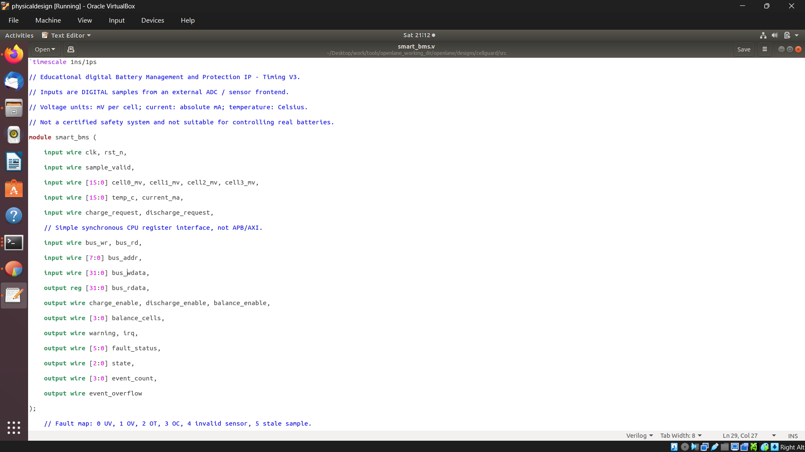
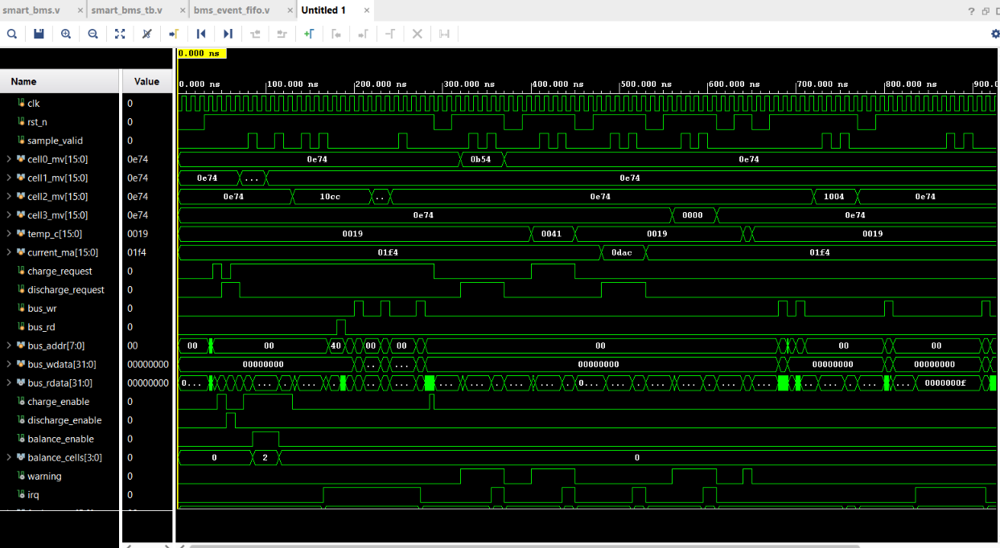
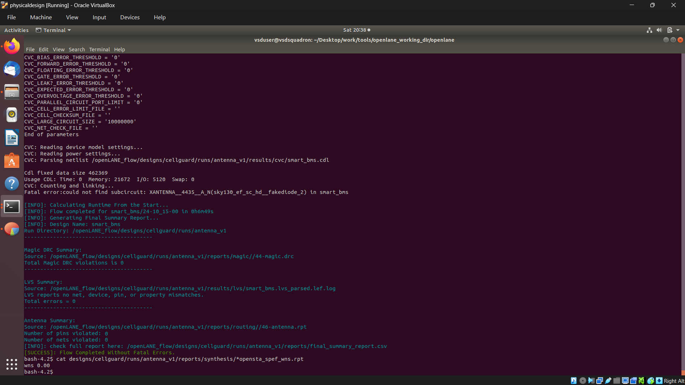
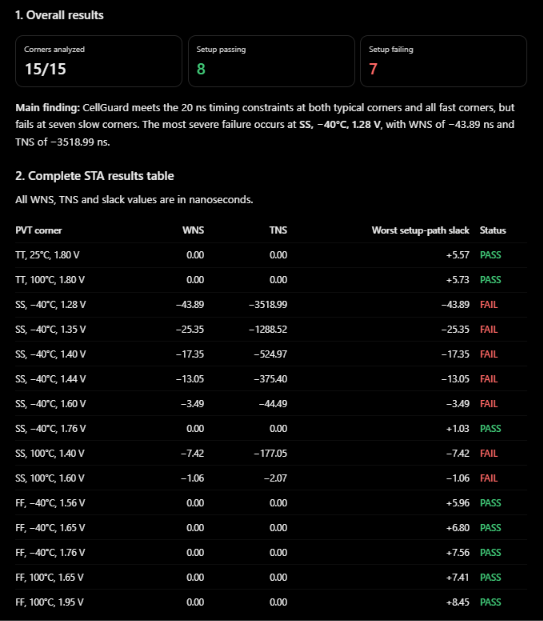
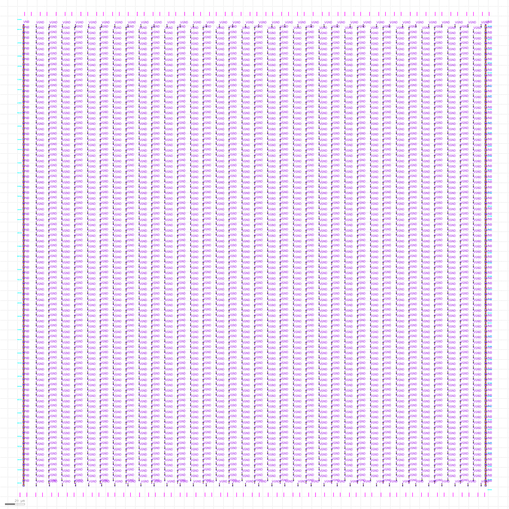
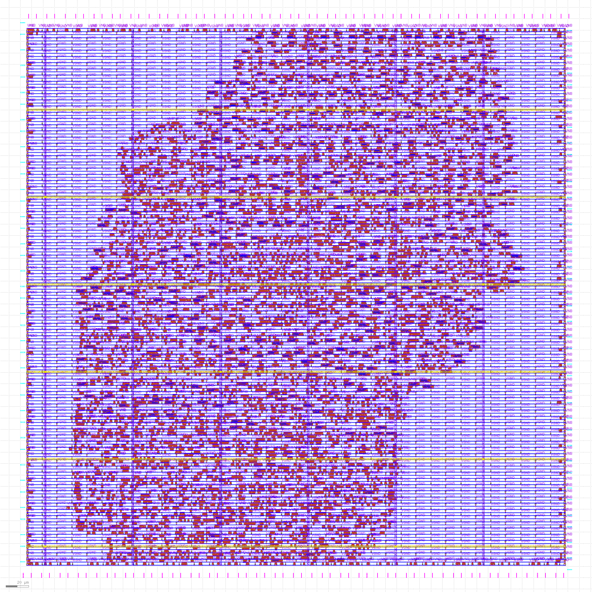
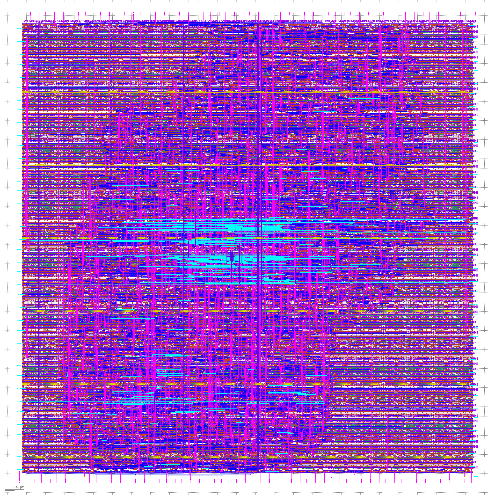
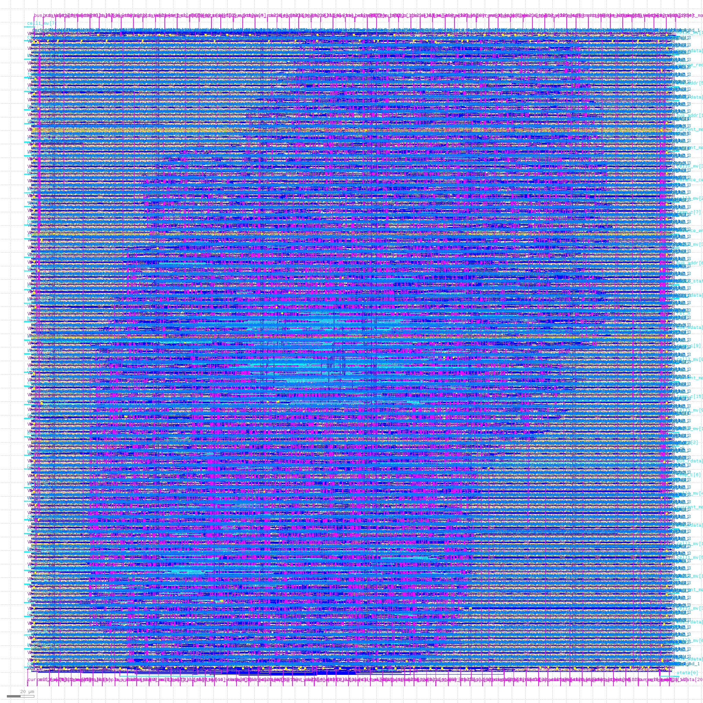

# CellSafe — RESULTS AND PROOF

### RTL-to-GDSII Implementation Using SKY130HD 130 nm Technology

## Project Overview

**CellSafe** is a Verilog-based Smart Battery Management and Protection Controller designed to monitor battery cell voltages, temperature, and current while providing protection against unsafe operating conditions.

The project demonstrates the **RTL-to-GDSII ASIC design flow** using Yosys, OpenSTA, OpenLane, OpenROAD, and Magic.

## 1. RTL Design

The `smart_bms` module implements four-cell battery monitoring, charging and discharging control, cell balancing, fault detection, and interrupt generation.

### RTL Module

The RTL uses combinational and sequential logic, including finite state machines, registers, counters, and protection comparisons.

## 2. Functional Verification

The RTL was verified using a Verilog testbench, with simulation waveforms visualized in GTKWave.

### Simulation Results

The simulation demonstrates normal charging and discharging, cell balancing, overvoltage, overtemperature, overcurrent, and fault handling.

## 3. RTL-to-GDSII Flow

The design was implemented using OpenLane with the SKY130HD standard-cell library.

### ASIC Design Flow

The flow includes synthesis, floorplanning, placement, clock-tree synthesis, routing, physical verification, and GDSII generation.

## 4. Static Timing Analysis

Multi-corner static timing analysis was performed using OpenSTA to evaluate the design under different process, voltage, and temperature conditions.

### Multi-Corner STA Results

| Parameter | Result |
|---|---|
| Technology | SKY130HD |
| Clock period | 20 ns |
| Target frequency | 50 MHz |
| PVT corners analyzed | 15 |
| Setup passing corners | 8 |
| Setup failing corners | 7 |
| Nominal TT corner | Passed |
| Worst WNS | −43.89 ns |
| Worst TNS | −3518.99 ns |

The nominal timing corner passes setup timing, while certain slow corners require further optimization.

**Detailed timing reports:**

- [Complete Multi-Corner STA Output](projectstaallcorners.txt)
- [Post-Resizer Min/Max Timing Report](10-opensta_post_resizer.min_max.rpt)
- [Post-Resizer WNS Report](10-opensta_post_resizer_wns.rpt)
- [Post-Resizer TNS Report](10-opensta_post_resizer_tns.rpt)

## 5. Floorplanning

Floorplanning establishes the die boundaries, core area, and physical regions for standard-cell placement.

### Floorplan Layout

This stage prepares the design for physical implementation by defining its layout dimensions and placement boundaries.

## 6. Standard-Cell Placement

Placement arranges the synthesized standard cells inside the core while considering timing, connectivity, and routing congestion.

### Placement Layout

The placement layout shows the physical arrangement of standard cells that implement the battery protection controller.

## 7. Clock Tree Synthesis and Routing

Clock Tree Synthesis distributes the clock signal to sequential elements. Routing then connects the placed standard cells using the available metal layers.

### Physical Design Layout

This visualization shows the physical layout and interconnections of the implemented controller.

## 8. Final GDSII Layout

The final GDSII layout represents the physical geometries of the implemented ASIC design.

### GDSII Layout Visualization

The layout can be inspected using Magic to observe standard cells, routing, power connections, and physical structures.

## 9. Final Implementation Results

The final OpenLane summary contains important physical design metrics, including area, cell count, utilization, timing, and physical verification results.

**[View Final Implementation Summary](final_summary_report.csv)**

| Metric | Description |
|---|---|
| Die area | Overall chip dimensions and area |
| Core area | Area available for standard-cell placement |
| Standard-cell count | Number of cells in the implemented design |
| Cell area | Total area occupied by standard cells |
| Utilization | Percentage of core area occupied |
| WNS / TNS | Timing performance |
| DRC violations | Reported physical design rule violations |

## 10. Project Results Summary

| Stage | Result |
|---|---|
| RTL development | Completed |
| Functional simulation | Completed |
| Logic synthesis | Completed |
| Multi-corner STA | 15 corners analyzed |
| Floorplanning | Layout generated |
| Placement | Layout generated |
| Clock Tree Synthesis | Included in physical implementation flow |
| Routing | Routed layout generated |
| GDSII generation | Layout generated |

## 11. Tools Used

| Tool | Purpose |
|---|---|
| Verilog HDL | RTL design |
| Vivado | Functional simulation |
| Yosys | Logic synthesis |
| OpenSTA | Static timing analysis |
| OpenLane / OpenROAD | Physical implementation |
| Magic | Layout visualization |
| SKY130HD | 130 nm standard-cell technology |

## 12. Conclusion

CellSafe demonstrates the implementation of a digital Smart Battery Management and Protection Controller through the RTL-to-GDSII design flow.

The project covers RTL development, functional verification, synthesis, multi-corner timing analysis, floorplanning, placement, clock-tree synthesis, routing, and GDSII layout generation.

The implementation provides practical experience with open-source ASIC design tools and highlights the importance of timing analysis and physical verification.

Although the nominal timing corner passes, further optimization is needed to address setup timing violations in some slow PVT corners.

---

